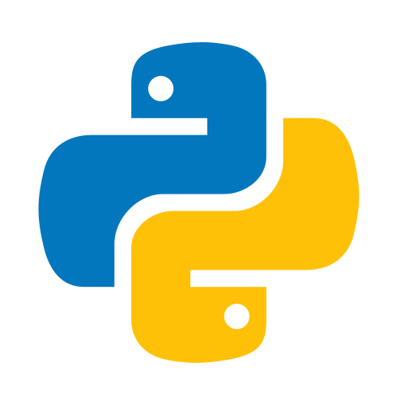

    
    <h1>🏛️ Introduction to Python Fundamentals 🏛️</h1>
    <i>These projects have been created as part of the 42 curriculum by npillet.</i>

 
The notions learned during these modules are explained in the README of the corresponding module. 
Below this paragraph, you will find, for each module, the grade obtained, a brief description of the module and the skills developed. 

**Language: Python** 

## 📜 Python Module 00

    

| Description | Skills |
| :--- | :--- |
| Introduction to Python programming through practical community garden scenarios. | - Object-oriented programming  - Rigor  - Imperative programming |

## 📜 Python Module 01

    

| Description | Skills |
| :--- | :--- |
| Learn Object-Oriented Programming by accidentally becoming a digital gardener - because apparently, the best way to understand classes is to grow virtual plants and realize you've been doing OOP all along! 📜💻 | - Object-oriented programming  - Rigor  - Imperative programming |

## 📜 Python Module 02

    

| Description | Skills |
| :--- | :--- |
| Build robust garden data pipelines that never wilt! Master Python exception handling through smart agriculture monitoring systems, learning to catch sensor failures, create custom plant alerts, and keep your digital greenhouse thriving even when things go wrong. | - Object-oriented programming  - Rigor  - Imperative programming |

## 📜 Python Module 03

    

| Description | Skills |
| :--- | :--- |
| Master Python’s powerful data structures while building and processing game data. | - Object-oriented programming  - Rigor  - Imperative programming |

## 📜 Python Module 04

    

| Description | Skills |
| :--- | :--- |
| Preserve digital knowledge by mastering file operations, managing data streams, and building robust archival systems that protect information. | - Object-oriented programming  - Rigor  - Imperative programming |

## 📜 Python Module 05

    

| Description | Skills |
| :--- | :--- |
| Master abstract classes, method overriding and subtype polymorphism by building data processing systems. | - Object-oriented programming  - Rigor  - Imperative programming |

## 📜 Python Module 06

    

| Description | Skills |
| :--- | :--- |
| Master Python's import system through alchemical experiments, including `__init__.py` package control, import styles, absolute vs relative imports, and circular dependency resolution. | - Object-oriented programming  - Rigor  - Imperative programming |

## 📜 Python Module 07

    

| Description | Skills |
| :--- | :--- |
| Master Python's design patterns with abstract classes and interfaces by building a modular card system. | - Object-oriented programming  - Rigor  - Imperative programming |

## 📜 Python Module 08

    

| Description | Skills |
| :--- | :--- |
| Welcome to the real world - this Matrix-themed project explore essential data engineering tools: virtual environments, package management (pip/Poetry), and environment variables through three progressive exercises where learners become data architects in Zion. | - Object-oriented programming  - Rigor  - Imperative programming |

## 📜 Python Module 09

    

| Description | Skills |
| :--- | :--- |
| Master Pydantic - Python's powerful data validation library - through space-themed exercises. Learn to create robust data models, implement custom validation rules, and handle complex nested structures while processing data. | - Object-oriented programming  - Rigor  - Imperative programming |

## 📜 Python Module 10

    

| Description | Skills |
| :--- | :--- |
| Master Python's advanced functional programming through FuncMage Chronicles - an epic cyberpunk RPG. Become a Function Mage in 2142, and use higher-order functions, decorators, and lambda spells to save the digital realm from chaos. | - Rigor  - Functional programming  |

 

 

    

