<div align="center">
    <h1>NetPractice</h1>
    <i>This project has been created as part of the 42 curriculum by npillet</i>
</div>

## Table of Contents
- [Description](#description)
- [Instructions](#instructions)
- [Submission Details](#submission-details)
- [Concepts Explanations](#concepts-explanations)
  - [IP Address](#ip-address)
  - [IPv4 and IPv6](#ipv4-and-ipv6)
  - [Public IP and Private IP](#public-ip-and-private-ip)
  - [TCP/IP](#tcpip)
  - [Subnet Masks](#subnet-masks)
  - [Default Gateways](#default-gateways)
  - [Routers And Switches](#routers-and-switches)
  - [OSI Layers](#osi-layers)
- [Exercises](#exercises)
- [Resources](#resources)

## Description
This project is an introduction to computer networking fundamentals. A few concepts will be discovered, such as:
 - TCP/IP Addressing
 - Subnet Masks
 - Default Gateways
 - Routers and Switches
 - OSI Layers

## Instructions
To launch the session, download the `net_practice.1.9.tgz` package and extract it.
Then run this command in the new folder containing the files:
```bash
./run.sh
```
It launches the web server in your default browser.

### Submission Details
To submit the project, the configuration of the 10 levels must be exported by using the `Get my config` button.</br>
Those exported levels have to be present at the root of the repository. There's one file per level.

## Concepts Explanations
### IP Address
It stands for **Internet Protocol Address**. It's a set of rules for communication over the internet. An IP address identifies a network or a device on the internet.</br>
It's composed of two important parts:
- Network ID
- Host ID

There are two types of IP addresses:
- **Static IP address**: It stays permanent and doesn't change. It is mostly used for important equipment such as businesses or servers among others.
- **Dynamic IP address**: It changes occasionally and is used for consumer equipment such as laptops, smartphones, tablets, ...

The purpose of IP addresses is to handle the connection between devices, identify them on the internet, and communicate with destinations like websites and streaming services.

#### IPv4 and IPv6
<div align="center">
  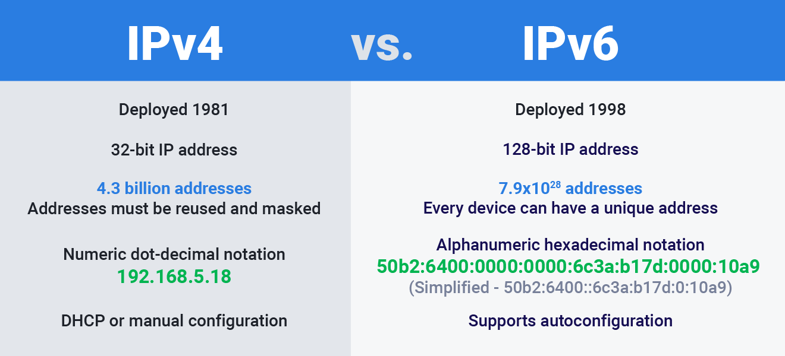
</div>

- **IPv4** uses 32-bit for the IP address. Because it's limited, addresses must be reused and masked. Because of this and the growth of the internet, a new version of IP was created.

- **IPv6**, compared to IPv4, uses 128-bit for the IP address. It has over 340 undecillion addresses; therefore, every device has its address in hexadecimal notation.

#### Public IP and Private IP
- **Public IP**: It can be accessed directly from the internet. This IP is assigned to your network router by your Internet Service Provider (ISP).

- **Private IP**: It's an address that your network router assigns to your device.</br>
Within the same network, each device is assigned a unique private IP address. This is how devices on the same internal network talk to each other. When a network is connected to the internet, it cannot use an IP address from the reserved private IP addresses.

The following ranges are reserved for private IP addresses:
```
192.168.0.0 – 192.168.255.255 (65,536 IP addresses)
172.16.0.0 – 172.31.255.255   (1,048,576 IP addresses)
10.0.0.0 – 10.255.255.255     (16,777,216 IP addresses)
```

### TCP/IP
It stands for **Transmission Control Protocol/Internet Protocol**, which is a set of rules that guide and allow computers to communicate on a network such as the internet.

TCP and IP are two separate computer network protocols:
- IP obtains the address to which the data is sent
- TCP is responsible for the data delivery once the IP address is found.

The TCP/IP job is to divide different communication tasks into layers that each have a different function. The data passes through four individual layers before it's received on the other end. TCP/IP then goes through these layers in reverse to reassemble the data.

Here are the four layers of the TCP/IP model:
<div align="center">
  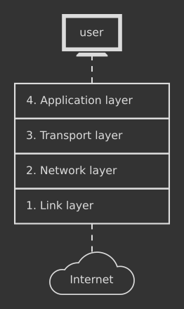
</div>

- **Link Layer**: Also called the *Physical Layer*. It's what handles the physical parts of sending and receiving data using Ethernet, WiFi, ...
- **Network Layer**: Also called the *Internet Layer*. It controls the movements of the packets around the internet.
- **Transport Layer**: It provides a reliable data connection between two devices. It divides the data into packets, knows the packets received from the other device, and makes sure the other device knows the packets it receives.
- **Application Layer**: It's the group of applications that require network communication, which is what the user typically interacts with, such as email and messaging. Since the lower layers handle the communication part, there's no need for the applications to concern themselves with it.

### Subnet Masks
Also called a **subnetwork**, a subnet is a network inside a network. They make networks more efficient.</br>
Subnetting is the process of stealing bits from the HOST part of an IP address in order to divide the large network into smaller ones called subnets.

| CIDR | Addresses | Hosts | Netmask | Class C Portion |
| :---: | :---: | :---: | :---: | :---: |
| /30 | 4 | 2 | 255.255.255.252 | 1/64 |
| /29 | 8 | 6 | 255.255.255.248 | 1/32 |
| /28 | 16 | 14 | 255.255.255.240 | 1/16 |
| /27 | 32 | 30 | 255.255.255.224 | 1/8 |
| /26 | 64 | 62 | 255.255.255.192 | 1/4 |
| /25 | 128 | 126 | 255.255.255.128 | 1/2 |

When choosing an IP, we need to look at the Netmask or CIDR. Depending on it, we have access to a range of addresses in which we don't use the first and last are reserved for network and broadcast respectively.

### Default Gateways
It's a node that forwards the packet from the source to other networks when there is no routing information about the destination.
It allows the communication of computers on different networks. This is commonly used for webpage access.</br>
`default` means the default route which is to be taken when the host doesn't know where the destination is.

<div align="center">
  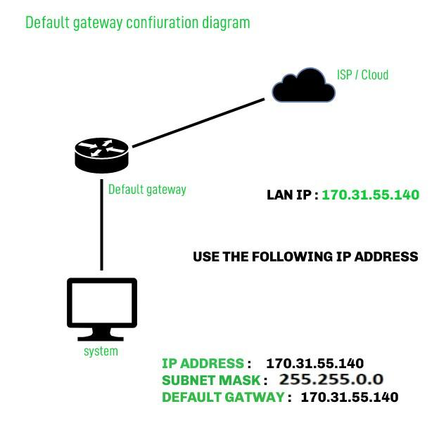
</div>

### Routers And Switches
#### Router
It's a device that connects two or more packet-switched networks or subnetworks.</br>
It serves two main functions:
- Managing the traffic between these networks by forwarding data packets to their intended IP addresses
- Allowing multiple devices to use the same internet connection

#### Switch
It's a device that connects devices within the same network, usually **LAN** (*Local Area Network*), and forwards data packets to and from those devices. Unlike a router, a switch only sends the data to devices it is intended for.

#### Routing Table
It's a data table which is stored in a router or network host that lists all the routes to a particular network destination.
<div align="center">
  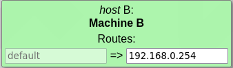
</div>

In this project, a routing table stores two types of information:
- **Destination** (left): This is the IP address to which you want to send a package; it is combined with the CIDR of its network. For instance, it can be `148.109.68.225/25`.
If the destination doesn't need to be specified, it can be set at either `default` or `0.0.0.0/0`.
- **Next Hop** (right): This is the IP address of the next router the packages will be sent to in order to reach the destination network.

### OSI Layers
It's a structure that explains how data travels. Here is a visual representation:
<div align="center">
  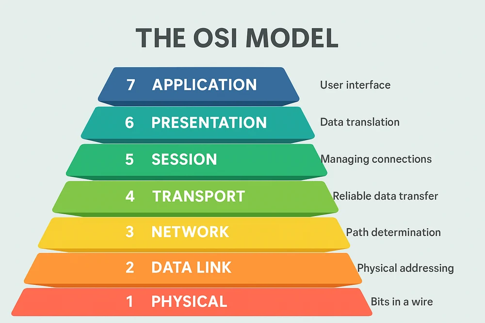
</div>

It's composed of 7 layers:
- **Physical Layer**
- **Data Link Layer**
- **Network Layer**
- **Transport Layer**
- **Session Layer**
- **Presentation Layer**
- **Application Layer**

## Exercises
  <details>
    <summary>Level 1</summary>
    </br>

  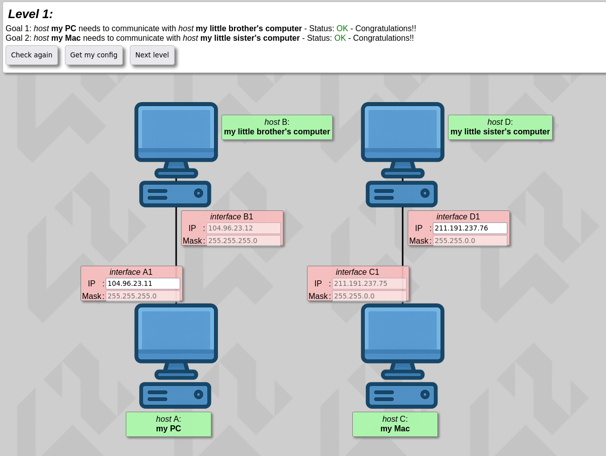
  A problem of direct communication between two devices is presented to us in that first exercise. They need to be in the same network to be able to communicate.
  </details>

---

  <details>
    <summary>Level 2</summary>
    </br>

  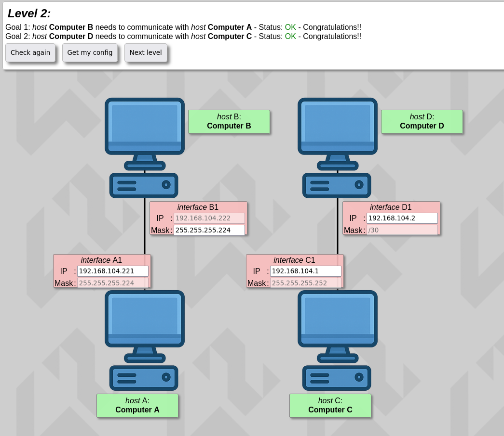
  For this one, a similar problem is displayed but this time masks can also be modified.</br></br>

  Because of this, we need to be careful of the mask used within the same network. It needs to be the same everywhere within it.
  </details>

---

  <details>
    <summary>Level 3</summary>
    </br>

  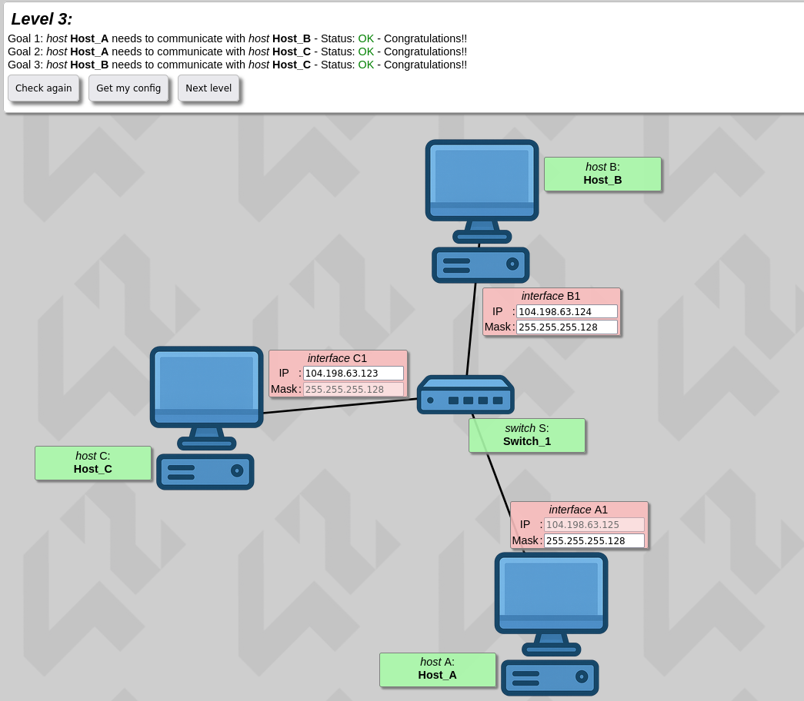
  This exercise introduces us to switches. Like explained above, switches can connect multiple devices together within a network.</br></br>

  Because of this, we need to be careful of the mask used by every device connected to the switch and of the IP address used for each device.
  </details>

---

  <details>
    <summary>Level 4</summary>
    </br>

  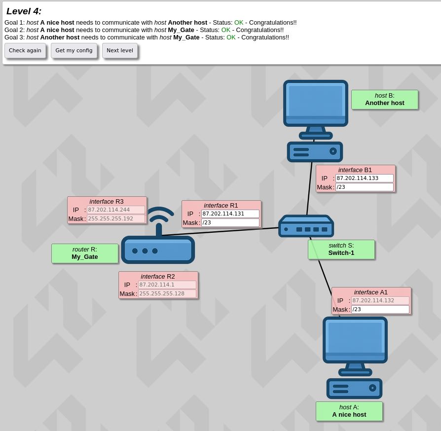
  In this exercise, a router is used. A router has different interfaces with each an IP address and a mask.</br></br>

  When defining each interface, we need to be careful that it doesn't overlap with each other.
  </details>

---

  <details>
    <summary>Level 5</summary>
    </br>

  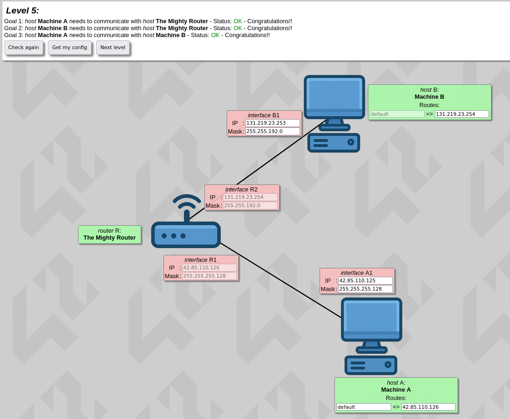
  Here we discover the routing table. Here, each host has one that can connect to the router, and therefore, to each other.
  </details>

<hr>
From here, three of the following exercises can be randomly selected for evaluation.
<hr>

  <details>
    <summary>Level 6</summary>
    </br>

  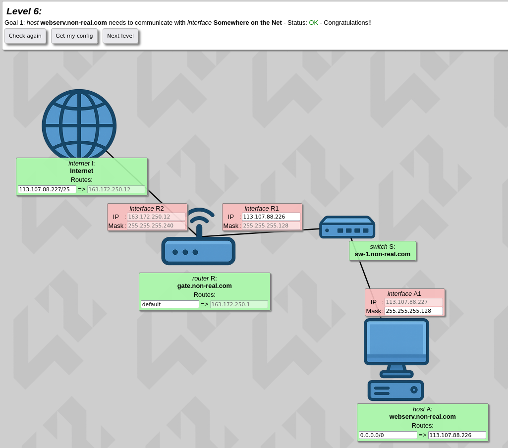
  This level introduces us to the Internet. The Internet is sort of a multiple interfaces router.</br></br>

  Here, we need to connect a device to the internet so it can communicate.
  </details>

---

  <details>
    <summary>Level 7</summary>
    </br>

  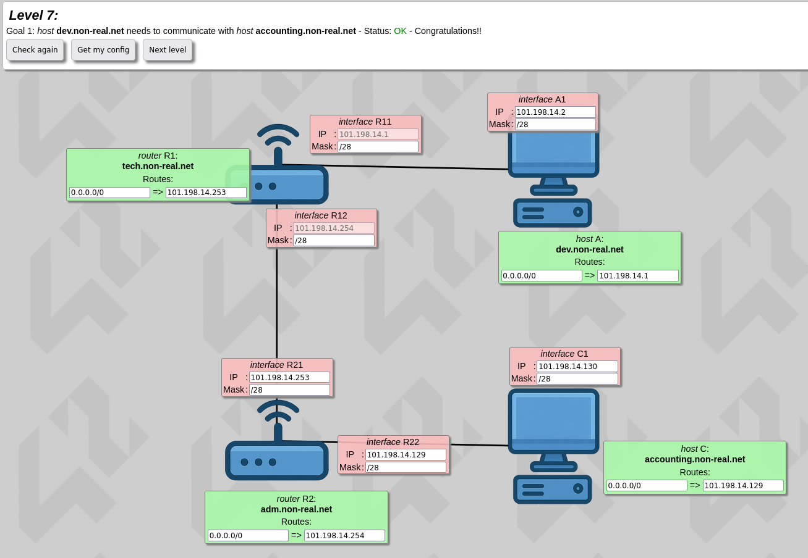
  In this exercise, understanding overlapping is the key to the solution.</br></br>

  Here, the three networks need to have their own range of IPs. They can also have their own subnet masks. There can be no overlaps of IP addresses between the networks of the same router.
  </details>

---

  <details>
    <summary>Level 8</summary>
    </br>

  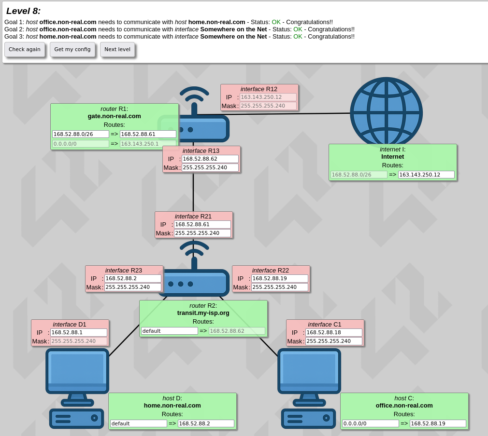
  In this one, two devices need to access the internet.
  </details>

---

  <details>
    <summary>Level 9</summary>
    </br>

  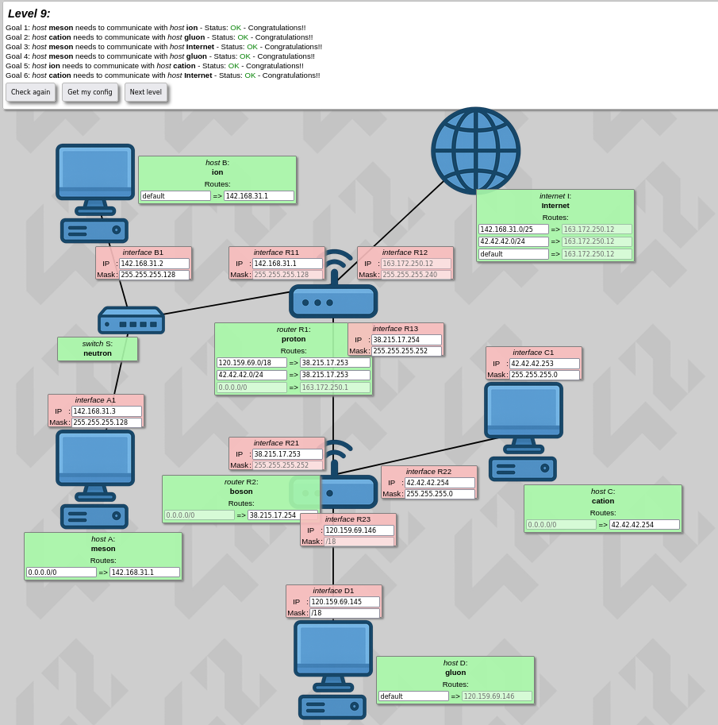
  For this exercise, a bit of every previous concept are used.
  </details>

---

  <details>
    <summary>Level 10</summary>
    </br>

  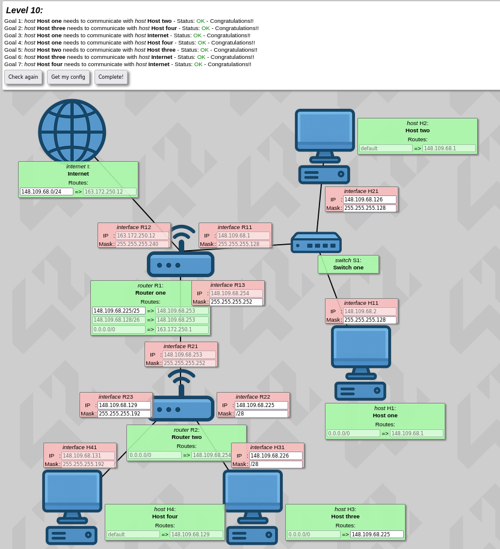
  For this final exercise, most of the settings are already configured.</br></br>

  We do need to be careful of the overlapping like in level 7. The internet has only one route configured; therefore, all networks must be within this range without overlapping.
  </details>

---

## Resources
### Notions
#### TCP/IP Addressing
- [TCP/IP Explanations](https://www.fortinet.com/fr/resources/cyberglossary/tcp-ip)

#### Subnet Masks
- [Subnet Mask Cheat Sheet](https://www.digicert.com/dns/subnet-mask-cheat-sheet)

#### Default Gateways
- [Default Gateway in Networking](https://www.geeksforgeeks.org/computer-networks/default-gateway-in-networking/)

#### Routers And Switches
- [Switches and Routers](https://www.formip.com/pages/blog/switch-et-routeur-difference)

#### OSI Layers
- [The OSI Model, Explained](https://www.network-supply.com/blogs/knowledge/the-osi-model-explained)

#### General Documentation
- [NetPractice Guide](https://medium.com/@imyzf/netpractice-2d2b39b6cf0a)

### GitHub
- [Overtekk](https://github.com/Overtekk/NetPractice)

- [caroldaniel](https://github.com/caroldaniel/42sp-cursus-netpractice)

<br>
<hr>
<br>

<div align="center">
    
</div>
