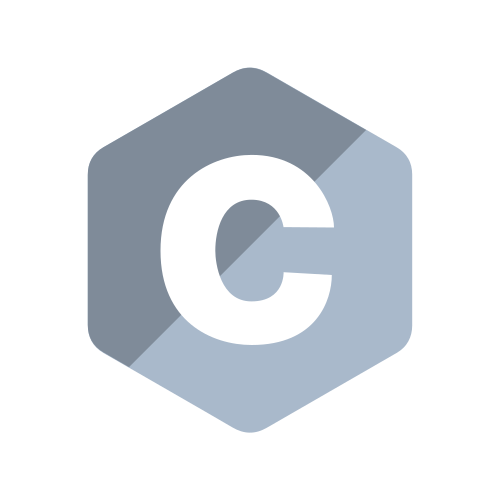
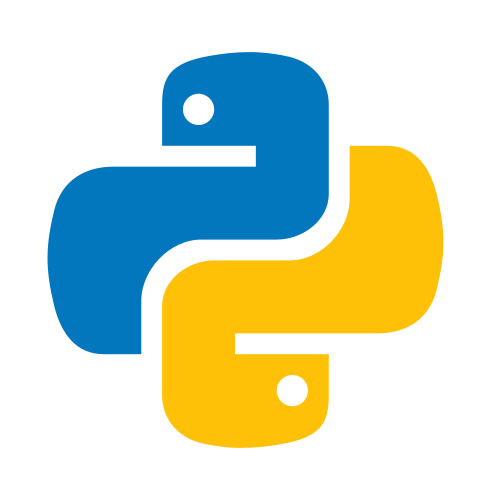
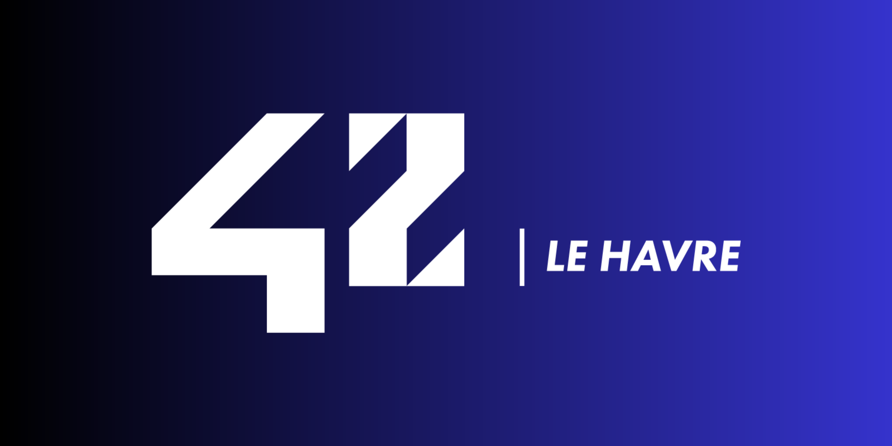

    
    <h1>🏛️ 42 Cursus 🏛️</h1>

This repository contains every project made during my 42 cursus sorted by circle of the common core. 
Below this short paragraph, you will find, for each project, the grade, a brief description of the project and the developed skills

## Circle 0
### 📜 Libft

    

| Description | Skills |
| :--- | :--- |
| Creation of my first library in C | - Rigor  - Imperative Programming  - Algorithms & AI |
**Language: C** 

## Circle 1
### 📜 ft_printf

    

| Description | Skills |
| :--- | :--- |
| Recoding the printf function in C | - Rigor  - Algorithms & AI |
**Language: C** 

### 📜 get_next_line

    

| Description | Skills |
| :--- | :--- |
| A program that reads a .txt file line by line | - Rigor  - Algorithms & AI  - Unix |
**Language: C** 

### 📜 Born2beRoot

    

| Description | Skills |
| :--- | :--- |
| Setting up my first Virtual Machine (VM) | - Rigor  - Network & System Administration |
**Language and Tool: Bash**  **& VirtualBox**

## Circle 2
### 📜 Push_Swap

    

| Description | Skills |
| :--- | :--- |
| A program that will sort values as fast as possible | - Rigor  - Imperative programming  - Algorithms & AI  - Unix |
**Language: C** 

### 📜 Python Modules

 
    

| Description | Skills |
| :--- | :--- |
| A serie of modules to learn the basics of the Python language | - Object-oriented programming  - Rigor  - Imperative programming  - Functional programming  |
**Language: Python** 

### 📜 A-Maze-ing

    

| Description | Skills |
| :--- | :--- |
| A program that randomly generates a solvable maze (Group project with <a href="https://github.com/Fredrnx">frrenaux</a>) | - Algorithms & AI  - Group & interpersonal  - Adaptation & creativity  - Graphics  |
**Language: Python** 

## Circle 3
### 📜 Call Me Maybe

    

| Description | Skills |
| :--- | :--- |
| A first introduction to coding an AI by learning function calling with a LLM | - Object-oriented programming  - DB & Data  - Algorithms & AI |
**Language: Python** 

### 📜 Codexion

 
    

| Description | Skills |
| :--- | :--- |
| A discovery of what threads and mutexes are and learning how they work | - Imperative programming  - Algorithms & AI  - Unix |
**Language: C** 

### 📜 Fly-in

    

| Description | Skills |
| :--- | :--- |
| A program that uses a path-finding algorithm | - Rigor  - Algorithms & AI  - Graphics |
**Language: Python** 

## Circle 4
### 📜 Pac-Man

    

| Description | Skills |
| :--- | :--- |
| A recreation of Pac-man (Group project with <a href="https://github.com/bebejamin1">bbeaurai</a>) | - Object-oriented programming  - Algorithms & AI  - Group & interpersonal  - Graphics |
**Language: Python** 

### 📜 NetPractice

    

| Description | Skills |
| :--- | :--- |
| An introduction to the basics of networking | - Rigor  - Network & system administration |

### 📜 RAG Against the Machines

    

| Description | Skills |
| :--- | :--- |
| A discovery of what Retrieval Augmented Generation (RAG) is | - Object-oriented programming  - Algorithms & AI  - DB & Data |
**Language: Python** 

 

 

    

